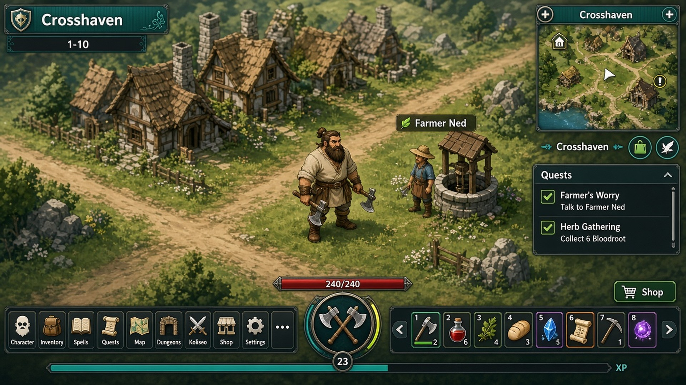
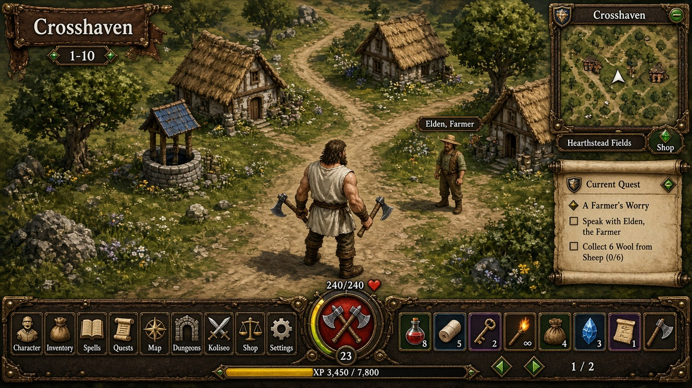
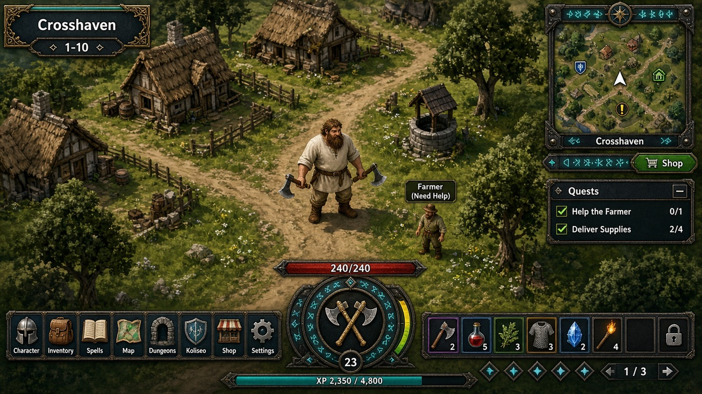
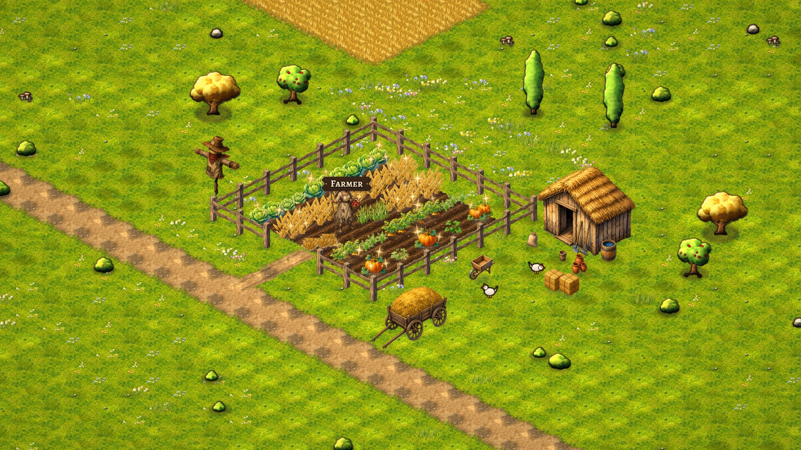

# U0 HUD style mockups (v1)

These are package **U0** (`pc/ui-style`) mockups from Scenario Art. Claude shortlists one, and Mauro chooses it, per `docs/pc/UI_SPEC_PC.md` on branch `claude/pc-zones-spec` (§1 visual language, §2 HUD, §7 packages). U0 is the three full-screen options Mauro picks from before U1 starts (§7: Claude shortlists, Mauro sees the chosen style).

Docs and images only. No game code. PC only. Do not merge this branch into `main` or `mobile`.

**Status:** v1 is rejected as a look match. Luca's feedback: they "do not look like our game". Scenario Art is waiting for Claude's direction before a redo.

## The three options

All three are 1920×1080 and carry the §2 HUD layout, including the square minimap (Mauro: square).

| Option | File | Look |
|---|---|---|
| **A** | [mockup_A_charcoal_teal_1920x1080.jpg](mockup_A_charcoal_teal_1920x1080.jpg) | Charcoal and teal. The most Wakfu-faithful of the three (§1: dark charcoal and deep teal panels). |
| **B** | [mockup_B_parchment_brass_1920x1080.jpg](mockup_B_parchment_brass_1920x1080.jpg) | Painted parchment and brass. |
| **C** | [mockup_C_iron_runes_1920x1080.jpg](mockup_C_iron_runes_1920x1080.jpg) | Dark ironwork with glowing teal runes. |

## Known problems

Luca: they "do not look like our game".

- The scene behind the HUD is a generic painted village invented by the mockup artist (brown thatched cottages, dark forest greens). It is not the real PC look.
- The hero and the NPCs are not our sprites.
- The frames were upscaled from 1280×720, so the UI text is approximate.

## Real Crosshaven reference

[real_crosshaven_frame_1920x1080.jpg](real_crosshaven_frame_1920x1080.jpg) is a real in-game Crosshaven frame at 1920×1080. The real look is bright flat yellow-green grass, dirt roads, red-roofed timber houses, a cobbled plaza and an obelisk.

## Waiting on Claude

Scenario Art is waiting for Claude's direction on which real frame, which hero sprite size, and any locked HUD look to use. If asked, it will redo the mockups on a real Crosshaven frame with the Ironjaw base sprite.

## v2

v2 follows Claude's direction. The files are under [v2/](v2/). The HUD is drawn on the real Crosshaven frame and covers about 7.6% of the screen. The bar is 1040×64, the slots are 44×44, the orb is 96 wide, and the minimap is 200×200. Text is real Nunito. The look is direction A, charcoal and teal, plus a light variant.

Known gaps:

- Built on the Crosshaven frame only. Frames 1 and 2 from PR #362 on branch `pc/ui-frames` weren't available yet.
- The minimap is a stylised redraw, not the real Crossroads layout, and the zone text is hardcoded to Crossroads.
- The level medallion overlaps the orb bottom edge.
- Gems, weapons, and armour icons are placeholders, and quest, spell, and rank text is invented.
- The real captured hero is about 156 px tall at 1080p, not 110–120 as in the spec, so HUD sizes may need rechecking against the real frames.

## v2 on the real frames

[v2_real/](v2_real/) is the same HUD re-rendered at scale 1.3 on the real frames from PR #362, so it matches the captured hero at about 156 px. At 1920×1080 the bar is 1352×83, slots and buttons are 57 px, the orb is 125 wide, and the minimap is 220×220. Zone text and the minimap are set per frame. Dark and light, at 1920×1080 and 1280×720.

Luca rejected the old fight frame for looking like the phone. Frame 2 uses the clean Granary capture (`frame2_granary_fight_clean.png`, PR #362, bd342c4, board zoom 1.417) and a new PC combat HUD: a timeline with portraits, round and timer; a hover target card; a room info panel; the orb with AP/MP pips; 2×8 spell slots with costs and a cooldown; End turn on Space; and a combat log. There is no face pad, because facing is by mouse. That HUD covers about 13.7% of the screen and leaves the fighters and the move tiles clear.

Known gaps: the timeline sits close to the back-wall name plates, hotkey labels are tiny at 1280, portraits are crops from the frame, the menu windows are still at 1.0 design scale, the Map window covers the hero, and the minimap art is approximate.
